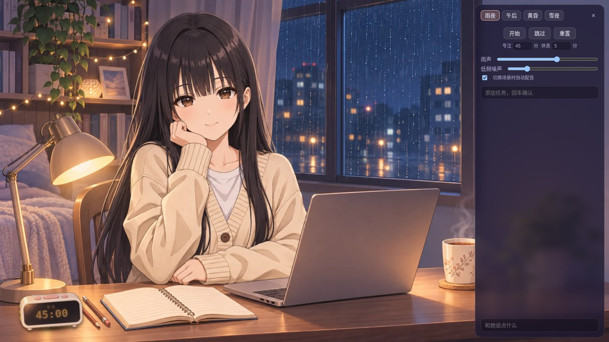
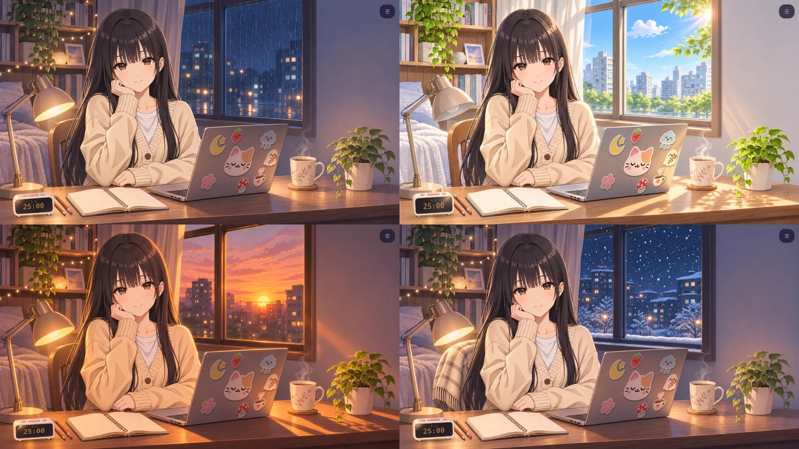

# quiet-nook

A cozy desktop study companion with two rooms: a floor-seated afternoon scene and the original desk room. A pomodoro timer appears as an alarm clock.





## Features

- The floor room has one afternoon scene and two static poses, 托腮 and 轻搭. Its character and room are separate images.
- The desk room has afternoon, dusk, rainy night and snowy night scenes, plus the 居家, 外出 and 睡前 looks. The desk character breathes, blinks and changes expression.
- A pomodoro timer appears on the floor or desk. Click the clock to start or pause. It beeps when a phase ends.
- Stickers on the desk room's laptop lid, baked into each scene image with the lid's perspective and lighting.
- The whole room, including the clock and her speech bubble, is canvas. The side panel is the only DOM element over it.
- She can operate the clock: say "I'm going to focus for a while" and she starts it.
- Chat with her. She sees the timer state and your to-do list.
- Synthesized rain and brown noise, no audio files.
- Everything is stored in the browser (`localStorage`). There is no account and no server-side state.

## Quick start

Requires Node 20 or newer and a browser with WebGL.

```sh
export ANTHROPIC_API_KEY=...   # or see the backend table below
npm start                      # http://127.0.0.1:7777
```

`./run.sh` starts the server and opens it as a standalone app window with Chromium or Chrome (`--app`).

Controls: use the room, scene and pose buttons at the top of the panel. Click the clock to start or pause. Keys `1`, `2` and `3` cycle expressions, scenes and poses respectively; `C` opens or closes the side panel. The floor poses do not yet have expression assets.

## Chat backends

The server keeps your key out of the browser. It picks a backend from the environment, or from `CP_BACKEND`.

| Backend | Selected when | Settings |
|---|---|---|
| `anthropic` | `ANTHROPIC_API_KEY` is set | `CP_MODEL` (default `claude-sonnet-5-5`), `ANTHROPIC_BASE_URL` |
| `openai` | `OPENAI_API_KEY` is set | `CP_MODEL` (default `gpt-4o-mini`), `OPENAI_BASE_URL` for any OpenAI-compatible endpoint |
| `opencode` | neither key is set | a running local [opencode](https://opencode.ai) service; `OPENCODE_URL` (its port changes on restart), `CP_MODEL`, `CP_PROVIDER` |

The server listens on `127.0.0.1` only. Set `HOST=0.0.0.0` only if you understand that anyone who can reach the port can spend your API quota.

## How it works

```
public/
  art/                       the floor room and its two transparent character sprites
  scene/<scene>/plate.webp   the empty desk room, including its desk
  looks/<look>/              full transparent sprites for neutral and emotion expressions;
                             blink.webp is an eye patch applied to the neutral sprite
  props/clock.png            the shared, independently rendered desk clock sprite
  char.js                    WebGL: room plate and character; a 2D canvas draws weather, clocks and speech
  app.js                 timer, to-do list, sound, chat, side panel
server.js, backends.js   static server and the chat proxy
```

She answers in a fixed format: an expression tag (`[neutral]`, `[happy]`, `[shy]`, `[sleepy]`, `[think]`, `[cheer]`), the text, and optionally an action tag (`[start]`, `[break]`, `[pause]`, `[reset]`) that the page executes on the clock. The system prompt is in `public/app.js`.

## Art pipeline

The images were generated with an AI image model and are not hand drawn. Approved composition and expression line drawings are in `docs/reference/`. Review a new line drawing before generating artwork when the composition or pose changes. Keep the desk clock separate from the room plate.

Desk looks and placement are defined in `public/char.js`. Use complete transparent, lossless WebP sprites for neutral and emotion expressions. Create blinking from the neutral sprite by applying only the eyes from a reviewed candidate with soft edges; check alignment, seams and flicker in the page. Keep the existing asset names.

## Limits

- The `anthropic` and `openai` backends have been exercised only with a dummy key (the request reaches the provider and is rejected). The `opencode` backend is the one used day to day.
- The animation is a few pixels of displacement of a painted image, not a rigged model. It reads as alive, not as a game character.
- On a very wide, short window the scene is cropped to fill it, so you see her face and part of the desk.
- She is a companion character, not a therapist. The prompt tells her to point you to people around you or a local helpline if you mention self-harm, and not to give a diagnosis. Do not rely on it for crisis support.

## License

MIT for the code, see `LICENSE`. The images in `public/scene` and `public/props` are AI generated and are not covered by the MIT license.
